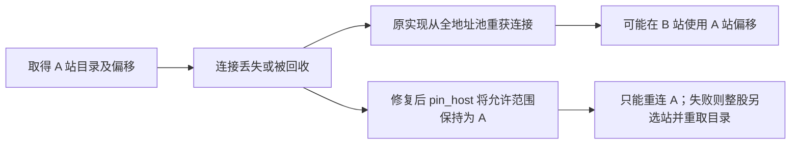

# F10 冷启动与正文错位修复（2026-10-22）

## 本次范围与结论

工程为 zsdtdx。修复公开公司信息接口的冷启动路由竞争、连接重新获取时的站点绑定漏洞，以及错位正文的交付与重试。股票和基金的有效上市资格筛选按用户决定暂不处理；本次不修改数值 parser、K 线或 `get_stock_stat`。

原应用复验指出：3.0.1 的冷启动公开接口仅成功 32/400；显式预装路由后虽完成 5,579 股，仍交付 5 篇标题错位正文。原异常运行没有保存当时的目录、实际 host 或逐帧回包，因此不能仅凭事后直取正确就认定是服务器一过性问题。

本轮完成两项独立的因果验证：

1. 在真实租约池里，故意在选站与实际目录/正文 IO 之间回收连接，原实现会从全地址池重新取租约，稳定出现 A/B 跨站。修复前新增两项回归均失败，修复后通过。
2. 用存留的目录和原始正文重建合并 `.txt` 的物理布局，将另一布局的偏移应用到它上面，5 篇异常的完整解码后 SHA-256 全部与应用端异常一致。这不是只比较头部关键字。

这证明了“目录定位与文件布局混用”的错误机制，并证明源码中确有能造成跨站的缺口。但缺少原始出错时刻的请求/peer 记录，仍不能断言那一次一定触发了本地跳站，也不能排除同一 IP 的源端目录/文件版本不一致。后续遇到同类问题必须保留发生时刻的链路。

## 冷启动竞争

3.0.1 的单股入口未找到 `_stock_route` 时执行 `get_all_stock_list(refresh=True)`。60 个工作线程可同时看到空路由；刷新锁只让它们依次强刷，没有让等待者复用第一个初始化结果。强刷还会清空派生视图，于是其它线程可能再次查不到有效代码。应用每轮销毁共享客户端，会使下一轮重新进入这一路径。

修改入口：

- `parallel_fetcher._iter_company_info_chunk_results` 在任何股票 chunk 提交前，由共享客户端准备标准股票路由。
- `UnifiedTdxClient.prepare_company_info_routes` 复用当日内存/磁盘缓存，在 single-flight 保护中建立路由，并归还协调线程下载码表占用的许可。
- 单股 `_company_info_route` 在未命中时双重检查，只执行 `refresh=False` 的按侧缓存加载，不再按代码触发全市场强刷。等待锁也检查截止时间与取消。
- 初始化失败时不提交部分股票任务，批次仍为每个请求代码生成唯一失败终态，保持 `成功 + 失败 = 请求数`。

调用方不用添加类型参数、手工预装路由或保留上一轮共享客户端。

## 连接绑定漏洞

旧实现先调用 `connect_company_info_host([A])` 取得 A 的连接，再调用 `call_current_host()`。后者会执行 `_ensure_connected()`；如果此时连接已被回收，租约池会按当前允许地址范围重新选站。只“当前连到了 A”并没有把后续连接重获的允许范围也限制到 A。

`PersistentFailoverPool.pin_host()` 现在把线程的 `eligible_hosts` 临时限制到目标站，退出时还原原范围。目录请求和每一篇正文的整个分页阶段都在该上下文中执行。因此重新取租约、重连和下一页 IO 都无法静默换到另一物理站。它不修改其它线程的地址范围，也不扩大能力组。

## 五篇异常全文的复原

历史 A 布局取自 `123.125.108.101:7709` 的目录，B 布局取自 `27.151.2.90:7709`。两者文件名均为同一股票的 `.txt`，但栏目在文件内的物理顺序不同。不能把目录逻辑顺序当作文件字节顺序，也不能跨站复用 start。

| 股票 / 栏目 | A 目录 start | B 布局正确 start | 错位量 | 原请求长度 | 完整 SHA 匹配 |
|---|---:|---:|---:|---:|---|
| 601319 / 主力追踪 | 332371 | 895476 | -563105 | 27293 | 是 |
| 601718 / 主力追踪 | 578685 | 613510 | -34825 | 19603 | 是 |
| 601718 / 经营分析 | 557218 | 592043 | -34825 | 21467 | 是 |
| 601718 / 股东研究 | 85009 | 63653 | +21356 | 27684 | 是 |
| 601718 / 财务分析 | 43690 | 22334 | +21356 | 41319 | 是 |

例如财务分析原文与紧随的股东研究原文拼接后，从字节 21,356 开始取 41,319 字节，得到 29,639 个字符，完整 SHA 为 `f7ebdb66d24997021308fbd522769c53d40685862410916647fff8e2db51f7a4`，与昨日异常一致。其余四篇也逐篇匹配完整哈希。

股东研究的表头在同一文件中重复出现；仅搜前 240 字会找到错误的第一个位置。取证脚本已遍历全部匹配起点，以完整 SHA 选中真实片段。机器可读证据见 `docs/evidence/company_info_cold_identity_2026-10-22.json` 的 `cross_layout_reconstruction.json`。

这些结果支持错位读取解释，没有证据要求改变目录 152 字节记录解析、正文 12 字节前缀切片、GBK 解码或分页步长。

## 正文身份与恢复

- 只在正文起始标题验证 `☆栏目☆ ◇六位代码`，代码必须精确匹配、栏目去空白后匹配。正文中段碰巧出现代码/栏目不能通过。
- 长度完整但非法 GBK 仍使用 `errors="ignore"`；它不是单独的重试原因。身份校验在解码之后进行。
- 任一栏目身份不符，本轮整股结果丢弃；同站重新取得一次目录和全部所选正文，仍异常才换站。换站后重新读取新站目录。
- 所有站都失败时抛 `content_failed`，detail 中含 `identity_mismatch`；同站重连失败可继续下一站，取消不改报正文失败。成功重试不污染最终失败计数。
- 空目录、候选栏目过滤和未出现的可选栏目维持原合同，不强制每股固定栏目数量。

## 最终验收

最终源码在原复验主机 `120.48.122.118` 的独立诊断目录执行；不安装进生产环境、不写生产目录。60 线程，所有主验收都直接调用冷启动公开接口，没有手工预装或注入路由，每轮结束销毁共享客户端。

| 场景 | 成功 / 请求 | 正文数 | API 秒 | 峰值 RSS MiB |
|---|---:|---:|---:|---:|
| 400 股冷启动第 1 轮 | 400 / 400 | 2000 | 11.958 | 200.75 |
| 销毁后 400 股冷启动第 2 轮 | 400 / 400 | 2000 | 8.572 | 232.16 |
| 多站全市场冷启动 | 5579 / 5579 | 27895 | 122.007 | 1240.63 |
| 合并 txt 单站 27.151.2.90 冷启动 | 5579 / 5579 | 27895 | 122.224 | 1239.48 |

最终累计 91,725 帧：没有 socket 同时被多个请求使用、目录与正文 peer 不同、目录解析不一致、发出的文件定位与目录不一致、wire 解压体与 parser 输入不一致、正文切片或拼接不一致、回包 market/code 不符、标题不符。各独立新进程只下载一次标准目录；同进程销毁重建的第二轮复用当日磁盘缓存。

这些逐帧观测检查的是本轮运行，不可倒推昨日异常时刻也不存在这些问题。远端缺少 numba，K 线预热报告失败后 F10 继续运行；本轮远端结论仅覆盖 F10。未向生产环境安装依赖。

完整回归 `436 passed`。覆盖 60 个并发冷启动调用、初始化失败记账、等待预算、目录/正文 IO 前回收连接、同站重取、换站恢复、全部失败、取消、同步/异步、GBK ignore 和资源回收。

另经同步公开接口实网复核 601319、601718、920176、罗牛山及此前非法 GBK 样本 002017、301516、603903：7/7 股、全部 112 篇实际栏目成功，起始身份均匹配。

## 证据与后续操作

- 远端隔离目录：`/home/ubuntu/f10_diagnostics/20261022_fix_trace`。
- 本机原始证据：`tests/manual/artifacts/company_info_2026-10-22/evidence_20261022.tar.gz`，SHA-256：`c33ea7ee460b10e29d532e8ffd50447a253323a669f5569e1313692d0d8489c9`。
- 仓库小型统计及五篇哈希：`docs/evidence/company_info_cold_identity_2026-10-22.json`。
- `tests/manual/trace_company_info_cold.py`：默认冷启动；可用 `--host` 做合并文件单站压力；`--warm-routes` 仅用于旧版错位复现，不是冷启动验收。`ZSDTDX_DIAG_SRC` 可指定隔离旧版源码。
- 取证保存真实请求、TCP 头、原始压缩体、解压体、目录字段、peer/socket/thread、逐页偏移、字节和文本校验；异常股保存本轮链路并加入持续跟踪。原始数据不进入安装包。
- 仍未实现默认生产路径遇错自动保存原始帧；后续若再出现错位，应在实际出错调用上开启此取证工具，不能再仅保存文本头与最终哈希。

本轮不发布新 PyPI 版本；源码修复应在后续版本发布时连同本报告核对。
