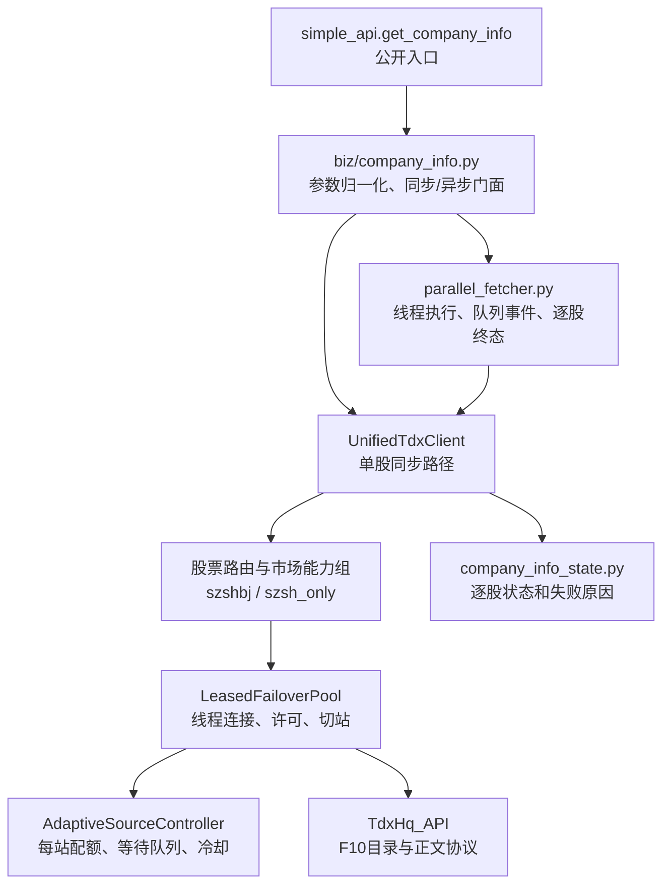

# zsdtdx 待改造事项

本文记录截至 2026-10-21 公司信息调度和首轮数值 parser 改造完成后，仍需继续确认或实施的事项。目标是让后续 agent 仅阅读本文并核对当前工程状态，就能理解问题背景、已完成边界、建议修改入口和验收门槛。已完成的改造仍保留证据与影响范围，避免后续重复修改或把局部结论扩大到其它协议。

## 项目与问题背景

`zsdtdx` 是从 pytdx 生态演进而来的独立行情库，当前同时包含标准行情、扩展行情、K 线、码表、财务、公司信息和并行调度。部分协议 parser 沿用了早期 pytdx 风格实现，部分网络与调度逻辑已按真实抓包和生产需求重写。因此不能假定“pytdx 原实现一定正确”，也不能因为某段代码历史较久就把当前问题归因于 3.0.0。

本轮改造源于应用端发现的两组问题：

1. 公司信息/F10 在多线程高并发时可能等待已满载的固定服务器，没有公平使用同能力组中的空闲服务器；正文失败、空结果、取消和部分成功的统计也存在不一致风险。
2. 证券目录及相关协议存在数值解析疑点。历史版本对比和真实位串重放确认，证券目录价格长期使用了错误的量能算法；后续全站全目录与 TdxQuant 核验已达到修改证据门槛，目录 parser 和标准 K 线量能的一个边界错误现已修复。

调查过程中还发现两个容易混淆的现象：

- 源端正文可能长度完整但含非法 GBK 字节。用户已明确这类情况应使用 `errors="ignore"` 保留其余正文；只有短页、空页或分页中断才按传输不完整报错。
- 行情响应曾有身份疑点，但缺少完整原始请求和回包，不能在证据不足时直接修改协议偏移。

当前继续遵循“每条协议独立取证、只修改已被真实数值证明的分支”的边界。不能因为目录和标准日 K 已通过，就推断实时行情、除权股本、板块或扩展行情全部正确。

## 当前架构与关键调用路径

公司信息调用大致经过以下层次：



后续修改时应先确认所处层次：

- `src/zsdtdx/simple_api.py`：公开函数参数和返回形式。
- `src/zsdtdx/biz/company_info.py`：公司信息同步/异步业务门面、代码归一化和统计出口。
- `src/zsdtdx/engine/parallel_fetcher.py`：全局线程执行器、提交窗口、结果队列、取消和销毁。
- `src/zsdtdx/engine/unified_client.py`：股票路由、F10 能力组、目录读取、正文分页、GBK 解码、逐站重试。
- `src/zsdtdx/engine/thread_runtime.py`：线程本地连接、租约安装/释放、F10 专用候选站准入和仍待改的通用固定目标切站。
- `src/zsdtdx/engine/adaptive_scheduler.py`：按数据源和服务器统计配额、等待、拥塞与冷却。
- `src/zsdtdx/util/company_info_state.py`：公司信息逐股终态和上下文传递。
- `src/zsdtdx/net/hq.py` 及对应 parser：目录/正文实际组包和解包；没有协议证据时不要修改偏移。

当前 F10 专用路径与通用路径的关键区别是：F10 的 `connect_company_info_host()` 把整个能力候选集合交给调度器，由调度器返回当前真正取得许可的服务器；通用 `_connect_to_index()` 仍先确定单个目标站，再最多等待该站 0.25 秒。正文一旦取得目录，所有分页固定目录所在站，失败后必须换站并从目录重新开始，不能把不同站的目录与正文混用。

## 后续 agent 开始工作前的检查

1. 阅读根目录 `AGENTS.md`，遵守中文文档、测试范围和连接池约定。
2. 执行 `git status --short`，区分本文所述改造与用户已有的未跟踪临时文件；不要批量加入或删除不相关文件。
3. 阅读 `docs/company_info_live_acceptance_2026-10-20.md`、`CHANGELOG.md` 当前未发布段和本文件对应事项。
4. 对目标函数查看当前实现和测试，不能只按本文行号修改；后续提交可能使行号变化。
5. 数值 parser 工作继续前先阅读 `docs/security_list_numeric_validation_2026-10-20.md` 和 `docs/kline_numeric_validation_2026-10-21.md`，保存新协议的真实原始报文和独立期望数值。
6. 每次只完成一类协议或一个跨业务调度阶段；验证通过后更新本文的已验证证据和剩余边界。

## 当前基线

本轮已经完成并验证以下内容：

- F10 目录与正文固定在同一实际服务器，正文分页期间不换站。
- F10 从当前市场能力候选集合中取得可用站，不再因为固定首站满载而阻塞空闲站。
- `None`、空页、短页、分页调用失败均按正文不完整处理；逐站重试耗尽后明确失败。
- 目录声明长度完整但含非法 GBK 字节时，使用 `errors="ignore"` 保留其余正文，并记录内部 `gbk_ignore_fallback` 状态，不把它误判为网络截断。
- 同步、异步、重复代码、无匹配候选栏目、坏端点切站、运行中销毁和资源回收已经通过确定性回归测试。
- 真网发现 5,580 条标准股票路由；全市场单栏目和全部候选栏目均完成。全部候选栏目共返回 27,900 篇正文，5,580 股成功、0 失败。
- 全市场正文头部的股票代码和栏目已在验收脚本中核对；所有批次结束后许可、连接占用和等待队列归零。
- 追加的完整 F10 目录验收覆盖 5,580 股、每股 16 个实际栏目、共 89,280 篇正文；正文头部代码和栏目全部匹配，0 股失败、0 项运行态失败。当前没有证据支持增加生产正文身份拦截，因此不再列为待改造事项。
- 罗牛山（000735）在 8 个能力站取得的 40 篇正文当天均可严格 GBK 解码。全市场另发现 3 篇长度完整但含非法 GBK 字节的正文；原始整文、逐页文件、长度和 SHA-256 已保存为验收证据。
- 0x044D 目录昨收已改为小端 `float32`，目录共享缓存版本已从 v3 升到 v4；旧缓存会失效重抓。
- 标准 K 线量能解码器的 `0x80` 边界已修正；全市场 TdxQuant 对照、长区间对照和 11 host 跨站对照均无倍数错误。

完整真网结果见 `docs/company_info_live_acceptance_2026-10-20.md`。

## 一、数值 parser：已完成项与剩余协议

### 现状与影响

证券目录协议中的价格 4 字节过去被当作无符号整数，再交给量能压缩算法解码；现已改为小端 `float32`。该错误不是 3.0.0 新引入：2.3.0 生产快照、2.4.0 和 3.0.0 证据副本均沿用相同错误逻辑。

量能算法还被用于或复制到以下路径，因此不能只修证券目录后就认定全部数值正确：

- 证券目录昨收价格：已修复，不再使用量能算法。
- 标准实时行情成交额。
- 除权除息信息中的股本字段；该路径已有零值单独处理，需要防止修复时破坏既有兼容逻辑。
- 标准股票/指数 K 线中的成交量和成交额；`parser/_kline_numba.py` 内的复制实现已同步修正 `0x80` 边界，其它分支保持不变。

扩展行情 K 线使用不同的固定记录、`float32` 或整数路径，不应与标准 K 线一起批量替换。

### 已验证

- 已使用真实 37 字节证券目录记录复现目录昨收错误。
- 已确认相关错误逻辑跨多个历史版本保持一致，因此不能将它描述为 3.0.0 回归。
- 已确认标准 K 线存在独立复制实现，只搜索 `get_volume()` 会漏改。
- 本轮 F10 真网验收没有改动或间接验证这些数值字段。
- 2026-10-20 已完成 11 个标准站的 0x044D 全目录核验：共保存 575,761 条 host×记录，52,448 个唯一 market/code 的 4 字节昨收在所有支持该市场的 host 上完全一致，未发现 host 使用不同编码。
- 参考站对 52,448 个目录身份逐项请求实时行情，按响应自身 market/code 对账；52,228 个正昨收经证券精度归一化后全部与目录小端 `float32` 一致。标准股票深 2,905、沪 2,318、京 351，共 5,574/5,574 匹配。
- 旧量能算法在全目录有 47,457 条因位型碰巧匹配，但有 4,771 条失败；没有一条“旧算法匹配而 float32 不匹配”。完整统计见 `docs/security_list_numeric_validation_2026-10-20.md`。
- 同次核验发现独立的实时报价精度问题：`GetSecurityQuotesCmd` 固定 `/100`，使精度 3 的 ETF/基金放大 10 倍、精度 4 的债券等放大 100 倍。该问题不属于 0x044D 编码差异，修改前需先确定可靠的 market/code 精度传递方式。
- 0x044D parser 已按小端 `float32` 修改；真实原码 920176 从旧错误值 352.19 修正为约 52.19，全零原码严格为 0。缓存格式已提升到 v4。
- TdxQuant 全市场近期对照覆盖 7,777 个标的和 145,579 根完整日 K；分层长区间覆盖 233,457 根共同日 K；80 个标的在 11 个标准站比较 18,258 个字段点，跨站差异为 0。
- 原码影子验收覆盖 306,578 个 0x052D 量额字段。`> 0x80` 改为 `>= 0x80` 只改变 1 条：511920.SH 2026-10-14 成交量从 32,768 修正为 1；TdxQuant、本地 `.day` 文件和修改后真网结果均为 1。
- 标准日 K 近期与长区间均无倍数错误；详细单位、容差、历史覆盖差异和盘中截止日说明见 `docs/kline_numeric_validation_2026-10-21.md`。
- 2026-10-21 已完成全部 7,777 个 TdxQuant 目录标的的其它标准周期验收：5 分钟自行聚合后逐根比较 890,783 根 15 分钟、445,393 根 30 分钟和 222,698 根 60 分钟 bar；日线自行聚合后比较 161,898 根周 bar。11 个银河节点分片请求均为 0 错误。
- 追加验收确认编码算法没有按 host/市场/产品变化，但服务端成交量单位会变：指数分钟线的银河量约为 TdxQuant 的 100 倍，标准周线对股票、基金、可转债、指数普遍以“手”返回，约为 TdxQuant 日线累加值的 1/100。可转债目录 `volunit=10` 但周线仍是 100 倍，因此两类规则不能合并为一次 `volunit` 乘法。
- 同一银河 IP 的不同连接会交替返回两套历史 OHLC，例如 300046.SZ 同一 15 分钟 bar 的开盘可为 41.60 或 42.22；成交量和收盘相同。该现象在两个入口复现，属于入口后端历史库版本差异，不支持修改价格 parser。
- 开盘时刻已并行取得 7,777 条 TdxQuant snapshot 和 7,777 条银河报价。7,710 条正昨收可比较记录的数量级全部支持 0x044D `decimal_point`：A 股 5,576 条为 2 位、基金 1,720 条为 3 位、可转债 320 条为 4 位、指数 94 条为 2 位。399001.SZ 仅有 0.01 元值差，反推精度仍为 2。
- TdxQuant `XsFlag` 是展示精度，不能代替协议精度：320 条可转债均为 `XsFlag=3`、目录 `decimal_point=4`。生产 parser 必须使用 0x044D 映射。

### 剩余改造要求

1. 为 `get_security_quotes` 设计可靠的 market/code → `decimal_point` 传递方式，再统一修正现价、昨收、开高低和五档价。精度来源已经由 TdxQuant 全市场并行反推确认，应使用 0x044D 目录映射；不得按代码前缀猜测，也不得使用 TdxQuant `XsFlag`。低层 API 在尚未加载目录时是保持兼容默认 `/100`、要求调用方显式传精度，还是触发目录加载，需要先明确接口合同。
2. 分别审计实时成交额和除权股本，保存原始四字节并找独立数值来源；不要因为它们调用同一个 `get_volume()` 就直接批量替换成 `float32`。
3. 为板块 0x0523 找到可一一对应的独立来源，验证其绝对 OHLC、成交量和成交额。当前仅能证明它复用了已修正的量能函数，不能证明整条板块协议数值都正确。
4. 统一标准 K 线成交量单位。若对外合同选择“最小成交单位”，指数 15/30/60 分钟需要将银河量除以 100，标准周线需要将银河量乘以 100；普通证券分钟线保持原值。修改前先补完整交易日历过滤：周线统一乘 100 后仍有 1,536 根倍数差异，现有样本证明其中一批是 TdxQuant 本地日线缺日，不能当作 parser 错误。月线尚未完成独立来源对照。
5. 为历史后端版本差异设计单独策略：至少保留响应 host、请求参数和 bar 身份；若要求结果确定性，可对异常 bar 重取并比较完整字段。不要把同一入口后端轮换造成的开/高/低差异写成差分解码修正。
6. 若要让 `simple_api.get_stock_kline` 支持 ETF/可转债，应单独修改公开目录路由和产品合同。底层 0x052D 已覆盖这些类型，不等于公开股票 API 已支持。

### 注意事项与验收门槛

- 当前目录缓存版本由 std、ex、ETF 共用。本次已接受统一升到 v4，因此升级后的首次调用会重建三类缓存；后续如频繁演进应考虑拆分版本。
- 目录缓存刷新不会自动刷新 F10 自有码表文件，也不会自动解决证券上市、退市和有效性筛选规则。
- 后续 K 线改动必须分别对同步、异步、标准股票、指数和板块调用做真实数值对照，不能用行数相同代替字段正确。
- 目前可以宣称“标准 0x052D 日 K 的全市场数值对照通过，已知 `0x80` 边界已修复；15/30/60 分钟与周线已完成全市场逐根对照并识别单位规律”。不能宣称所有 K 线周期均已统一：指数分钟和周线尚未改变生产返回单位，周线参照源缺日尚需过滤，月线尚未独立验收。
- 实时行情价格刻度、实时成交额、除权股本和板块 K 线仍需要独立证据。

## 二、生产环境的受限原始页取证闭环

### 现状与影响

本轮验收工具已经能针对已知异常文档保存原始整文、逐页二进制、服务器、目录字段、请求偏移、返回长度、页哈希和 GBK 错误位置，但生产代码遇到异常时仍不会自动保存这些证据。若再次出现历史正文错位、短页或服务器间内容差异，仅靠最终文本和错误日志仍难以还原根因。

### 已验证

- 002017、301516、603903 三篇非法 GBK 文档已完成原始字节取证；声明长度与实收长度一致。
- 三篇严格 GBK 解码分别发现 2、49、2 个非法字节。
- 301516 的后段同时存在大量控制字符和乱码，说明 `ignore` 只能保留剩余字节，不能修复源端正文。
- 短页、空页和分页中断已有确定性故障测试，候选站耗尽后会明确失败。

### 改造要求

1. 只在明确错误或指定股票代码时启用取证，默认不保存所有正文。
2. 保存目录原始结果、实际服务器、文件名、分类下标、起始位置、声明长度、每页请求参数、每页实收长度、阶段耗时和最终状态。
3. 原始页按收到顺序流式写入，避免大正文重复驻留内存。
4. 对单文件、单股票、单次运行和总目录设置容量及数量上限，并采用可预测的淘汰策略。
5. 对原始文件及每页记录 SHA-256，使后续能够证明样本是否一致。
6. 取证失败不能覆盖原业务错误，也不能使正常请求变成失败。

### 注意事项与验收门槛

- 配置和日志中可能出现服务器地址；不得保存凭据、用户自定义敏感路径或无关业务数据。
- 应同时测试磁盘不可写、容量耗尽、进程取消和多线程写入，确认不会泄漏许可或连接。
- 验收至少覆盖短页、空页、非法 GBK、换站重试和运行中销毁。

## 三、其它业务的通用选站公平性

### 现状与影响

F10 已新增按市场能力候选集合取得任一可用站的专用准入路径。通用连接切站 `_connect_to_index` 仍先固定目标服务器，并最多等待该服务器 0.25 秒配额；当目标站满载而同能力组其它站空闲时，其它业务仍可能发生不必要等待或失败。

该问题的必要性不低，但修改影响标准行情、K 线、财务和可能的双连接池协作。本轮只有 F10 场景具备完整复现证据和能力站语义，因此没有直接全局替换。

### 已验证

- F10 的“满载 A、空闲 B”回归测试已经通过，证明候选集合准入可以解决已知阻塞。
- F10 单许可、多站、高并发、坏端点和取消场景已验证许可与连接最终归零。
- 尚未证明其它业务的所有候选服务器都具备等价协议能力，也尚未完成其它业务的真网矩阵。

### 改造要求

1. 列出 `_connect_to_index`、rotate 和各业务建连入口的完整调用关系。
2. 为每种业务明确能力集合、是否允许任意站、是否要求与前序请求同站以及是否依赖双连接池。
3. 将“选择候选站”和“安装具体连接”拆开：调度器先公平取得可用许可，再连接许可指向的实际站。
4. 失败、超时和取消路径统一归还许可；连接失败不得把未使用的站长期降权。
5. 保留显式指定服务器的诊断和测试能力，避免通用公平选择破坏强制同站场景。

### 注意事项与验收门槛

- 分别测试标准行情、扩展行情、股票/指数/板块/期货 K 线、码表和财务接口。
- 每类至少覆盖满载 A/空闲 B、全部满载、首站协议失败、连接超时、请求超时、取消、销毁和重启。
- 比较改造前后相同输入的代码集合、行数、关键字段和内容哈希；行情类还要核对响应身份、乱序、缺项、重复项和陌生代码。
- 只有所有业务完成离线故障测试和受控真网对照后，才能删除 F10 专用路径或将其合并进通用实现。

## 四、公开结果合同与栏目完整性

### 现状与影响

当前内部运行态已能区分成功、无数据、取消和多种失败原因，异步统计也按逐股唯一终态生成。但公开的公司信息结果仍主要是 `code/category/content` 三列，调用方无法直接知道某篇是否使用 GBK ignore、某个候选栏目是否不存在、经历了多少次重试，或某股是否只返回了部分请求栏目。

候选栏目与必需栏目的语义尚未确定。应用当前传入的六个候选名称通常只对应五个实际栏目；把每个缺失候选栏目都判失败会制造假失败，而仅以“至少返回一篇”判整股完整又可能掩盖必需栏目缺失。

### 已验证

- 缺少可选候选栏目不再写成最终运行失败，全市场复测运行态失败为 0。
- 完全无匹配栏目时会得到明确 `no_data`，不再形成静默空成功。
- 同步、异步和重复输入均满足逐股唯一终态，终态总数与归一化代码总数一致。

### 待决定与改造要求

1. 决定保持正文列表/DataFrame不变并新增独立状态接口，还是升级公开返回结构为“正文加逐股/逐栏目状态”。
2. 明确 `category` 参数表示候选栏目还是必需栏目；如需两者并存，应使用不同参数表达。
3. 状态至少应包含股票代码、最终状态、尝试次数、实际服务器、逐栏目状态及原因；非法 GBK 可作为成功附带诊断，而不是失败。
4. 保持兼容时应提供迁移周期，不能无提示改变现有 DataFrame 列和返回类型。

### 注意事项与验收门槛

- 无论采用多少终态，所有终态计数之和必须等于归一化后的股票总数。
- 中间重试错误与最终失败必须分开，不能用一次准入超时代表最终失败股票数。
- 同步、异步、队列事件、`result()` 和运行态查询必须来源于同一终态，不得各自重新推算。

## 五、历史异常与未决证据

以下事项目前只有线索，不应在缺少原始证据时直接改协议或 parser：

- 605020 不同内容：现有证据支持服务器或文档版本差异，不支持修改偏移算法。
- 标准行情历史占位/错码线索：保存样本中底层 parser 会保留响应 market/code，当前没有证据证明公开 `simple_api` 按请求位置覆盖身份。应先补响应乱序、缺项、重复项和陌生身份测试。
- 301516 股东研究正文：长度完整但后段大面积乱码，按当前业务约定使用 GBK ignore 成功返回。若应用需要“可读性质量”判断，应另设诊断规则，不能把启发式乱码判断混同于传输截断。

## 建议实施顺序

1. 先确定公开结果合同和候选/必需栏目语义，避免后续状态字段重复迁移。
2. 实现受限原始页取证，为历史异常复现提供证据。
3. 单独开展通用选站公平性改造，并按业务逐项验收。
4. 数值 parser 继续按协议逐项修复；下一优先级是实时报价 `decimal_point` 传递设计，以及明确指数分钟/标准周线的公开成交量单位合同。随后再处理实时成交额、除权股本、板块和月线。

每一项完成后都应更新本文：保留验证证据和实际边界，将对应事项移出待办，避免用单次真网成功代替确定性故障测试，也避免把局部修复描述成全局完成。

## 证据位置与复核命令

仓库内证据：

- `docs/company_info_live_acceptance_2026-10-20.md`：本轮 12 个基线真网场景、1 个追加全目录场景、全市场结果、GBK 与截断语义及限制。
- `docs/security_list_numeric_validation_2026-10-20.md`：0x044D 全站全目录原码、实时行情对账和 float32 修改依据。
- `docs/kline_numeric_validation_2026-10-21.md`：TdxQuant 全市场/长区间/跨 host 对照、0x80 边界原码和修改边界。
- `tests/test_company_info_packets.py`：F10 协议组包、分页、短页、GBK、北交所 market 和同站约束。
- `tests/test_company_info_admission_regression.py`：候选站公平准入、配额等待/取消、部分正文、空目录和逐站重试。
- `tests/test_company_info_accounting_regression.py`：同步/异步逐股终态、失败重试、超时、取消、重复/缺失结果对账。
- `CHANGELOG.md` 与 `README.md`：本轮外部行为说明。

本机原始验收证据位于：

- `C:\Users\pkwccheng\Desktop\f10\f10_probe\validation\2026-10-20_company_info_live\summary_complete.json`
- `C:\Users\pkwccheng\Desktop\f10\f10_probe\validation\2026-10-20_company_info_live\cases\`
- `C:\Users\pkwccheng\Desktop\f10\f10_probe\validation\2026-10-20_company_info_live\gbk_forensics\`
- `C:\Users\pkwccheng\Desktop\f10\f10_probe\validation\2026-10-20_company_info_live\run_live_acceptance.py`
- `C:\Users\pkwccheng\Desktop\f10\f10_probe\validation\2026-10-20_numeric_parser\analysis.json`
- `C:\Users\pkwccheng\Desktop\f10\f10_probe\validation\2026-10-20_numeric_parser\tdxquant_kline\summary.json`
- `C:\Users\pkwccheng\Desktop\f10\f10_probe\validation\2026-10-20_numeric_parser\tdxquant_kline\raw_volume_decoder_audit.json`
- `C:\Users\pkwccheng\Desktop\f10\f10_probe\validation\2026-10-20_numeric_parser\tdxquant_kline\aggregated_periods_report.json`
- `C:\Users\pkwccheng\Desktop\f10\f10_probe\validation\2026-10-20_numeric_parser\tdxquant_kline\decimal_point_tdxquant_live.json`

这些本机文件不是安装包的一部分。后续环境若没有这些路径，应以仓库内验收报告作为既有结论，并重新生成新的独立证据，不要伪造或猜测旧原文。

建议的离线复核命令：

```powershell
py -m pytest tests/ -q --ignore=tests/test_simple_api_retry_e2e.py --ignore=tests/test_user_acceptance_tcp_config.py -p no:cacheprovider
py -m ruff format --check src/zsdtdx/biz/company_info.py src/zsdtdx/engine/adaptive_scheduler.py src/zsdtdx/engine/parallel_fetcher.py src/zsdtdx/engine/thread_runtime.py src/zsdtdx/engine/unified_client.py src/zsdtdx/simple_api.py src/zsdtdx/util/errors.py src/zsdtdx/util/company_info_state.py tests/test_company_info_packets.py tests/test_company_info_admission_regression.py tests/test_company_info_accounting_regression.py
py -m ruff check src/zsdtdx/biz/company_info.py src/zsdtdx/engine/adaptive_scheduler.py src/zsdtdx/engine/parallel_fetcher.py src/zsdtdx/engine/thread_runtime.py src/zsdtdx/engine/unified_client.py src/zsdtdx/simple_api.py src/zsdtdx/util/errors.py src/zsdtdx/util/company_info_state.py tests/test_company_info_packets.py tests/test_company_info_admission_regression.py tests/test_company_info_accounting_regression.py
git diff --check
```

以上 ruff 文件列表对应本轮实际改动；后续 agent 应把自己新增或修改的 Python 文件加入检查。当前仓库另有两个未被本轮修改的 parser 文件不符合 ruff 默认格式，不应为了无关事项混入提交。

修改前的离线套件基线为 369 个用例通过；本次数值修改新增了目录 float32、旧缓存拒绝和量能 0x80 边界测试。真实 TCP 全市场验收耗时和服务器内容会随网络变化，不应放入普通单元测试；重跑时必须固定已完成交易日，保留独立配置、批次报告和原始异常字段，不能把盘中日柱的时点差异算成 parser 错误。
